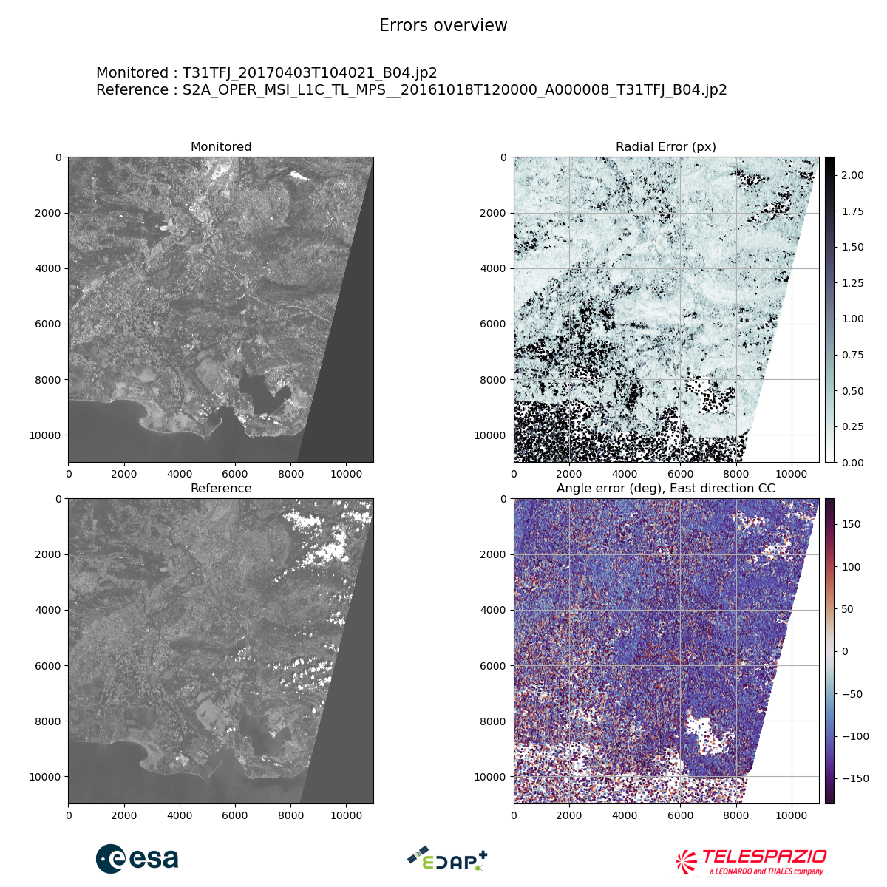
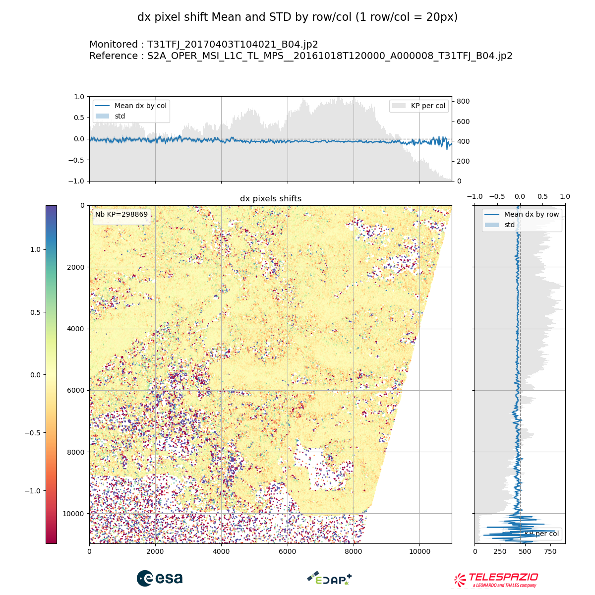
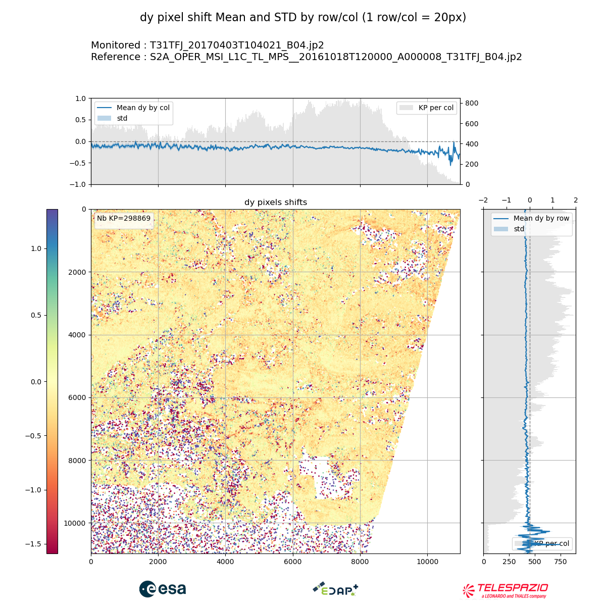
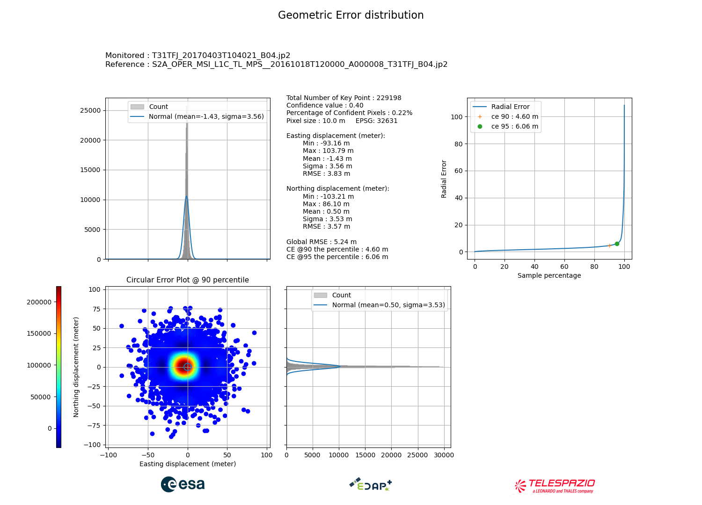
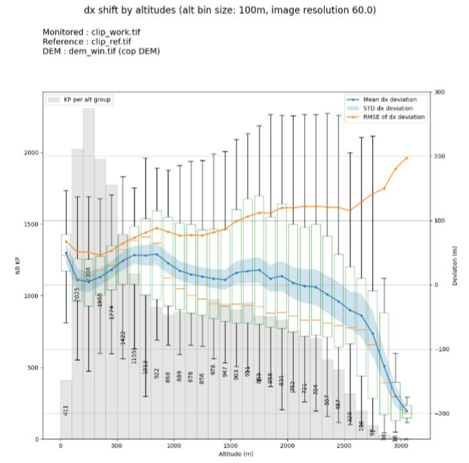
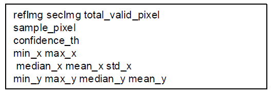
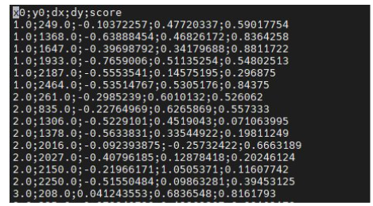
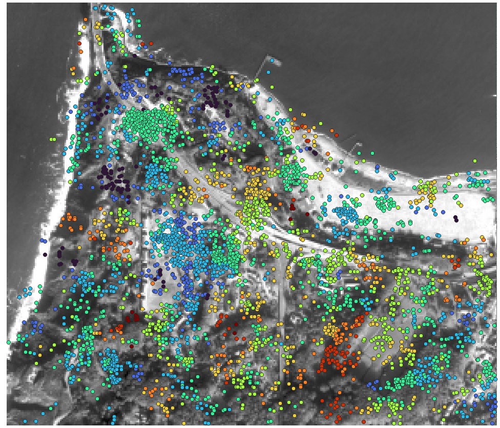

(output)=

# Understand KARIOS output data and plots

This section reviews all the outputs generated by KARIOS, including plots and intermediate products.

## 1. HTML report

`report.html` is the entry point of a run. It links the other pages through a tab bar at the top. Tabs only appear for the outputs that were generated.

| Tab | Page | Shown when |
|-----|------|-----------|
| Summary | `report.html` | always |
| Products | `products.html` | at least one product was written: always with georeferenced inputs (the GeoJSON), plus the rasters asked for with `--generate-key-points-mask` and `--generate-intermediate-product` |
| Mosaic | `mosaic.html` | `--mosaic-tile-size` is not 0 |
| Overlay | `overlay.html` | `--generate-overlay` |
| Chips | `chips.html` | `--generate-kp-chips` |

### 1.1 Summary tab

```{figure} report_summary.png
:name: report-summary
:width: 100%

Summary tab of a Landsat-8 / Sentinel-2 pair: input images, configuration (collapsed), statistical summary and matching confidence. Further down: the plots.
```

- **Input images**: monitored, reference, mask and DEM file names.
- **Configuration** (collapsed): the settings of the run. Values set to `auto` are replaced by what was selected, so the table shows the Laplacian kernel size and polarity actually used, along with the Laplacian power, pixel size, large shift and coarse-to-fine switches, followed by the KLT, shift and accuracy parameters.
- **Statistical summary**: matched points, valid pixels, mean and standard deviation in X and Y, CE90 and CE95.
- **Matching confidence**: a verdict, *reliable*, *doubtful* or *unreliable*, with a confidence percentage. KLT returns key points even between two unrelated images, and statistics computed on them look like a measurement, so this card tells you whether to trust the numbers. It combines up to three indicators:

  | Indicator | Meaning |
  |-----------|---------|
  | Median ZNCC | correlation of the patches around the confident key points (about 0 for unrelated images) |
  | Coherent key points | share of key points moving within 1 px of the shift of their neighbours |
  | Tracking ratio | share of detected corners kept by KLT's forward-backward check |

  The confidence is the mean of the indicators, each mapped to 0–1. Above 70 % the matching is *reliable*, below 30 % it is *unreliable*. When it is not full, the card lists which indicators fall short. An unreliable verdict usually means unrelated images, or a misregistration beyond the matching range: try `--enable-large-shift-detection` or `--enable-coarse-to-fine`, or run `karios align` first. The ZNCC indicator is missing when a large shift was applied, and the tracking ratio with `--resume`.
- **Visualizations**: the plots of [section 2](#2-plots), and the DEM plots if a DEM was given.
- **Key point coverage**: with `--debug` only, a grid over the monitored image giving the density and the matching quality of the key points per cell. A high point count is not a proof of a good registration, since the points can cluster in the most textured areas and leave the rest unmatched.

### 1.2 Products tab

```{figure} report_products.png
:name: report-products
:width: 100%

Products tab: one row per file written, with its type and a download link.
```

The tab lists the optional products written next to the report, one row per file. The *Download* link is relative, so the report keeps working when the results folder is moved or served as is.

| Type shown | File | Written when | Content |
|------------|------|--------------|---------|
| Mask (GeoTIFF) | `kp_mask.tif` | `--generate-key-points-mask` | Binary mask on the reference grid, 1 at the pixel of each key point, 0 elsewhere. Shows where the matching found points, and where it did not. |
| Raster (GeoTIFF) | `kp_delta.tif` | `--generate-intermediate-product` | Two bands on the reference grid, band 1 the dx and band 2 the dy of each key point, in pixels. |
| Vector (GeoJSON) | `kp_delta.json` | always, if the reference image is georeferenced | One point per key point, in the CRS of the reference image, with the properties `dx`, `dy`, `score`, `radial error`, `angle`, and `zncc_score` and `mutual_info_score` when computed. |

All three share the grid and the georeferencing of the reference image, so they open directly over it in QGIS. Style `kp_delta.json` by `radial error` or by `zncc_score` to see where the registration is good or doubtful (see [3.3](#33-key-points-mask)). When the reference image is not georeferenced, the GeoJSON is skipped with a warning, and the tab only appears if a raster was asked for. The Laplacian images of `--generate-intermediate-product` are not listed here, see [3.4](#34-laplacian-images).

### 1.3 Mosaic and Overlay tabs

Two ways to check the registration by eye, at native resolution:

- **Mosaic**: a checkerboard alternating reference (blue) and monitored (red) tiles, each histogram equalized. A misregistration breaks the features at the tile edges.
- **Overlay**: the monitored image in red over the reference in cyan. Aligned features are gray, shifted ones are fringed in red and cyan.

### 1.4 Chips tab

```{figure} report_chips.png
:name: report-chips
:width: 100%

Four chip pairs, sorted by chip number. Top row: reference (left) and monitored (right) image. Bottom row: the Laplacian of each, the images the tracker matched. Under each pair: dx, dy, ZNCC and NMI.
```

Small windows of both images around the selected key points, for visual inspection. Each chip pair shows the reference (*Ref*) and the monitored (*Mon*) chip side by side, 57 × 57 pixels displayed at twice the size, with a crosshair on the key point. The reference crosshair is at the chip center, the monitored one is displaced by the measured dx / dy: if the match is right, both crosshairs sit on the same feature.

Under each pair: the key point position, dx, dy, the ZNCC and the NMI (normalized mutual information) scores. The buttons at the top sort the chips by index, by shift distance, by ZNCC or by NMI, which brings the worst or the largest shifts first. Links to the VRT mosaics of all the chips are also given (see [Chip images](../usage.md#chip-images-optional)).

When the Laplacian chips exist (see [3.5](#35-laplacian-chips)), a second row of each pair shows the *Ref Laplacian* and *Mon Laplacian* chips, the images the tracker actually matched.

### 1.5 Worked example: reading the confidence verdict

The statistics of a run always look like a measurement, even when the images do not match. The *Matching confidence* card is there to tell the two cases apart. Here are two runs on the same Sentinel-2 scene, one against a Landsat-8 image of the same area, the other against a rotated copy of itself.

#### A reliable run

Landsat-8 band 4 (monitored) against Sentinel-2 band 4 (reference), both at 30 m:

| Indicator | Value | Score |
|-----------|-------|-------|
| Median ZNCC | 0.75 | 1.00 |
| Coherent key points | 100 % | 1.00 |
| Tracking ratio | 68.7 % (13743 / 20000 corners) | 1.00 |

Each value reaches the top of its ramp (ZNCC 0.5, coherent points 70 %, tracking ratio 20 %), so each scores 1. The confidence is their mean, 100 %, and the verdict *reliable* (see the Summary figure above). The card lists no reason, and the statistics can be used as they are: a mean shift of about −0.4 px in X and −0.5 px in Y, with a standard deviation of about 0.2 px, a tight, consistent offset.

#### An unreliable run

The same Sentinel-2 image against a copy of itself rotated:

```{figure} report_unreliable.png
:name: report-unreliable
:width: 100%

Statistical summary and matching confidence of an unrelated pair.
```

| Indicator | Value | Ramp (0 → 1) | Score |
|-----------|-------|--------------|-------|
| Median ZNCC | 0.05 | 0.1 → 0.5 | 0 |
| Coherent key points | 12 % | 20 % → 70 % | 0 |
| Tracking ratio | 4.2 % (833 / 20000 corners) | 5 % → 20 % | 0 |

All three fall at or below the level of unrelated images, so the confidence is 0 % and the verdict *unreliable*. The card says which indicators fall short and why, and that the images may be unrelated or misregistered beyond the matching range.

Look at what the statistics alone say: a mean of −0.14 and −0.07 px looks excellent. It is an average of shifts pointing in random directions. What gives it away is the spread, a standard deviation of about 2.5 px (against 0.2 px above) and a CE90 of 165 against 28, and above all the three indicators.

#### In between

The confidence is the mean of the three scores, each a linear ramp between the level of unrelated images and the level of related ones. For instance, a median ZNCC of 0.30, 45 % coherent key points and a tracking ratio of 12.5 % each score 0.5, so the confidence is 50 %: *doubtful*. The thresholds are 70 % for *reliable* and 30 % for *unreliable*. This last case is computed by hand to illustrate the rule, it is not an actual run.

#### What to do

| Verdict | Meaning | Action |
|---------|---------|--------|
| reliable | The images match, the statistics are a measurement. | Use the results. Check the [Overlay](#13-mosaic-and-overlay-tabs) if you want to see it. |
| doubtful | Some indicators are low. The matching may hold in some areas only. | Look at the [chips](#14-chips-tab), sorted by ZNCC, and at the coverage plot (`--debug`). Try other [Laplacian settings](../usage.md#laplacian-tuning). |
| unreliable | The images may be unrelated, or misregistered beyond the matching range. | Check that both inputs show the same scene and are on the same grid. Then try `--enable-large-shift-detection` or `--enable-coarse-to-fine`, or align first with `karios align`. |

## 2. Plots 

### 2.1 Error overview maps

The error overview maps show the monitored image, reference on the left and the keypoints map on the right. For each point, the radial error in pixel (top) and the angle error (bottom) are displayed.



### 2.2 X/Y pixel shift by rows and columns

These outputs show the pixel shift mean and standard deviation by rows and columns, for both x and y directions.





### 2.3 Geometric Error Distribution

This output provides :

* The circular error graph that gives a global view on the pixel shift distribution and the geometric shift tendencies, as well as the histograms in both directions with mean/sigma values. 
* The global statistics: min, max, mean, STD, RMSE.
* The radial error plot with circular error (90%/95%).




### 2.4 Geometric shift by altitudes distribution

This output provides the evolution of the mean / STD / RMSE of the deviation against elevation values, groupped as bins. These plots are generated if the DEM is provided in the KARIOS command line (--dem) and contain :

* A plot for the dx deviation 
* A plot for the dy deviation
* A plot for radial error




## 3. Files

### 3.1 TXT File

This file contains all the global useful information to be easily extracted : 

* Monitored image name 
* Reference image name 
* Total number of valid pixels
* Pixel sampling
* Confidence threshold for accuracy analysis
* Min/max values in x/y
* Median/Mean/STD values in x/y



### 3.2 CSV File

This file contains for every detected corner :

* The x/y coordinates 
* The shift along x/y in meters
* The confidence score



### 3.3 Key points mask

This mask is a GeoTIFF file containing for each detected keypoint :

* dx/dy shift in pixel 
* Confidence score 
* Radial error
* Angle error
* ZNCC score if available

This file is also available as a JSON file that can be viewed on QGIS : 



### 3.4 Laplacian images

The Laplacian image is the 2D second derivative of the input images (monitored and reference) which is used in the KLT process as the basis to detect corners. It can be useful to examine these images to see if they are similar and comparable, as they are determinant for corners detection.

This output can be activated by using --generate-intermediate-product.

```{figure} lap_3m.png
:name: lap
:width: 600px

Computed laplacian - Skysat / USGS LiDAR at 3 meters
```

### 3.5 Laplacian chips

With `--generate-kp-chips`, KARIOS also writes the chips of the Laplacian images, the ones the KLT tracker really matches. They show what the matching sees: if the two Laplacian chips of a pair do not look alike, the matching is unreliable there, whatever the shift the tracker returned. Typical causes are opposite contrast between the sensors (see `laplacian_invert_polarity`), a kernel size unsuited to the structures (see `laplacian_kernel_size`) or a Laplacian power far from the sensors' needs (see `--laplacian-power`).

They are computed with the kernel sizes and the power of the run. With `laplacian_kernel_size: "auto"`, they use the size pair selected by the sweep.

```
results/
├── chips/               # raw chips
└── chips_laplacian/
    ├── {monitored_filename}/
    │   ├── MON_1234_5678.TIFF
    │   ├── sprite.png
    │   └── monitored_chips.vrt
    └── {reference_filename}/
        ├── REF_1234_5678.TIFF
        ├── sprite.png
        └── reference_chips.vrt
```

The chips have the same names as the raw ones. `sprite.png` packs all the chips of an image in one picture, which the *Chips* tab uses to display them. The VRT files open all the chips as one mosaic in QGIS.

```{include} ../_includes/endnote.md
```
