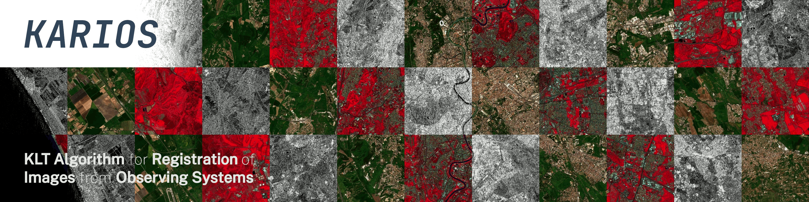

.. Karios documentation master file, created by
   sphinx-quickstart on Thu May 16 15:01:02 2024.
   You can adapt this file completely to your liking, but it should at least
   contain the root `toctree` directive.

.. disable right sidebar

:html_theme.sidebar_secondary.remove:

.. raw:: html

    

.. .. important::
..     Site under construction

.. This title is not displayed due to custom css above (h1)

Welcome to Karios's documentation!
==================================

.. toctree::
   :hidden:
   :maxdepth: 1
   :caption: Contents:

   quickstart
   usage
   case_study/index
   cookbook/index
   references

.. raw:: html
   
     

.. include:: welcome.md
   :parser: myst_parser.sphinx_

Videos
======

.. raw:: html

    <h3>Understanding the KARIOS report</h3>
    
Tour of the HTML report: summary, products, mosaic, overlay and Laplacian chips.

    <video controls preload="none" width="100%" style="max-width: 960px;">
      <source src="_static/videos/karios-report-demo.mp4" type="video/mp4">
    </video>

.. raw:: html

    <h3>Scenario 1 - Landsat 8 / Sen2Like</h3>
    
Dense matching (minDistance 5) of a Sen2Like L2H image against Landsat 8.

    <video controls preload="none" width="100%" style="max-width: 960px;">
      <source src="_static/videos/scenario-1-ls8-sen2like.mp4" type="video/mp4">
    </video>

.. raw:: html

    <h3>Scenario 2 - Sentinel-2A / Sentinel-2C commissioning</h3>
    
Key points mask output, explored in QGIS down to the metadata of one key point.

    <video controls preload="none" width="100%" style="max-width: 960px;">
      <source src="_static/videos/scenario-2-s2a-s2c-commissioning.mp4" type="video/mp4">
    </video>

.. raw:: html

    <h3>Scenario 3 - Landsat MSS / Sentinel-2 GRI with a DEM</h3>
    
Shift analysis against altitude using a DEM.

    <video controls preload="none" width="100%" style="max-width: 960px;">
      <source src="_static/videos/scenario-3-mss-gri-dem.mp4" type="video/mp4">
    </video>

.. raw:: html

    <h3>Scenario 4 - SPOT / BSG large offset</h3>
    
Detect a large offset, correct it with karios align, then process again.

    <video controls preload="none" width="100%" style="max-width: 960px;">
      <source src="_static/videos/scenario-4-spot-bsg-large-offset-align.mp4" type="video/mp4">
    </video>

.. raw:: html

    <h3>Scenario 5 - SAR / Sentinel-2</h3>
    
Multi-sensor matching, SAR against optical.

    <video controls preload="none" width="100%" style="max-width: 960px;">
      <source src="_static/videos/scenario-5-sar-sentinel2.mp4" type="video/mp4">
    </video>

.. raw:: html

    <h3>Scenario 6 - Interband and key point chips</h3>
    
Registration between two bands, with key point chips (-gkc).

    <video controls preload="none" width="100%" style="max-width: 960px;">
      <source src="_static/videos/scenario-6-interband.mp4" type="video/mp4">
    </video>

.. Indices and tables
.. ==================

.. * :ref:`genindex`
.. * :ref:`modindex`
.. * :ref:`search`
